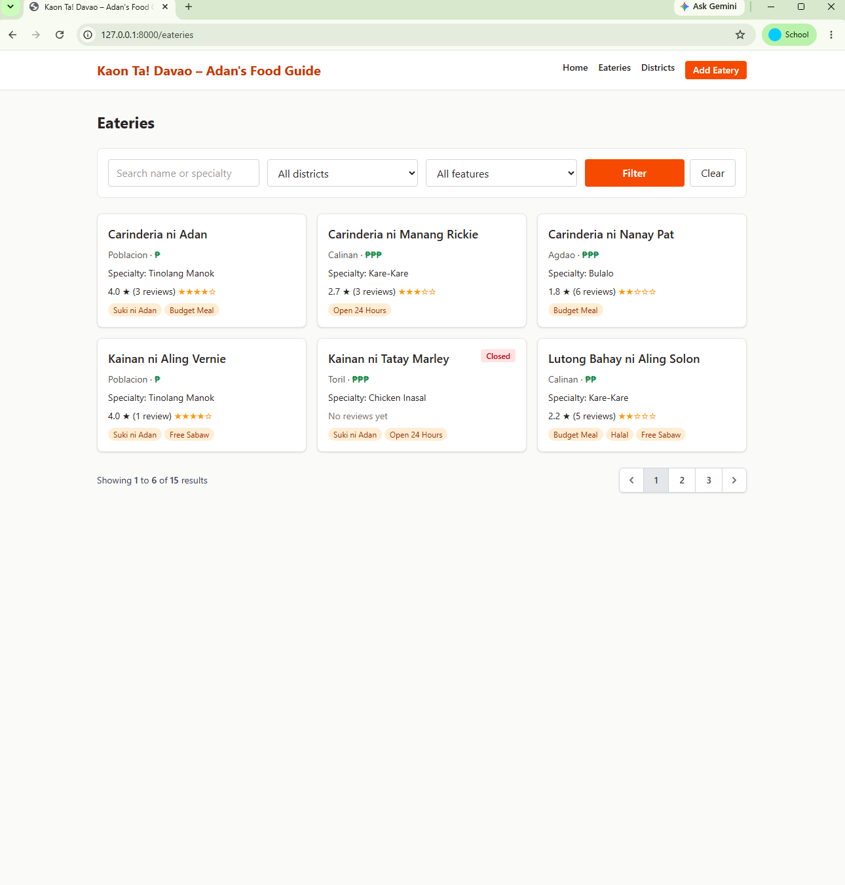
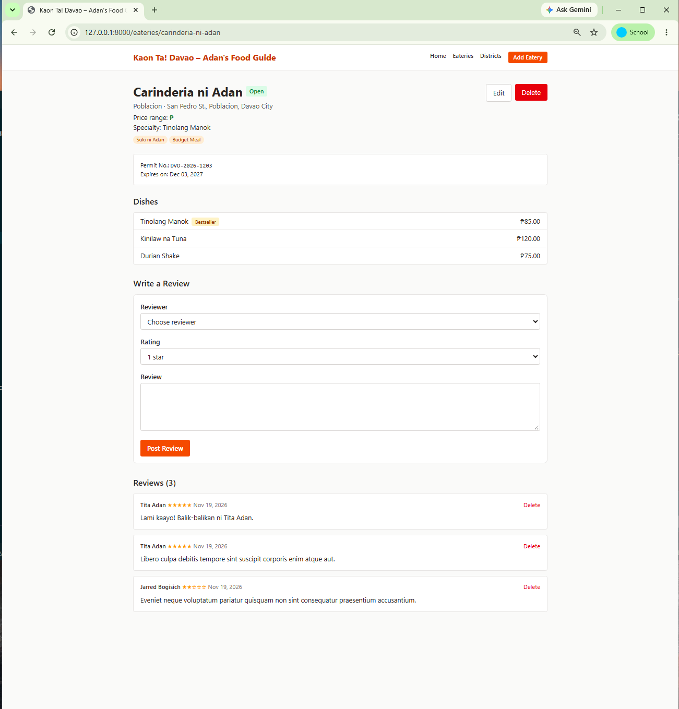
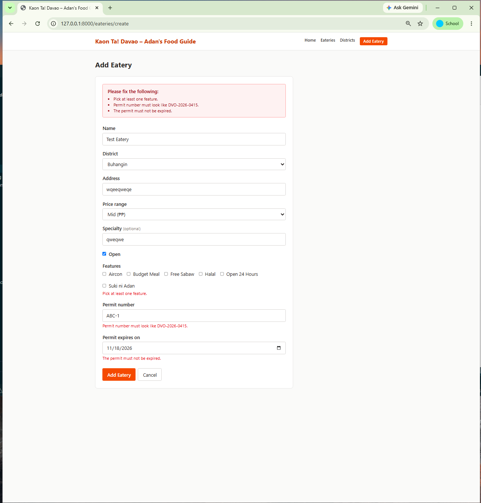

# Kaon Ta! Davao – Adan's Food Guide

by Dion Ren Adan

A Laravel 12 food guide for carinderias and eateries around Davao City, built with SQLite, Blade and Tailwind CSS.

## Setup

```bash
composer install
cp .env.example .env
php artisan key:generate
touch database/database.sqlite
php artisan migrate:fresh --seed
npm install
npm run build
php artisan serve
```

Then open http://127.0.0.1:8000 in your browser.

## Personalized data

The seeders always create the following data. Everything else (14 more eateries, their permits, dishes, features and reviews, and 10 more users) comes from factories.

### Districts

1. Poblacion
2. Talomo
3. Agdao
4. Buhangin
5. Toril
6. Calinan

### Features

1. Suki ni Adan
2. Budget Meal
3. Halal
4. Open 24 Hours
5. Aircon
6. Free Sabaw

### Users

| Name | Email | Password |
|---|---|---|
| Dion Ren Adan | adan@kaonta.test | kaonta2026 |
| Tita Adan | tita.adan@kaonta.test | kaonta2026 |

Passwords are stored hashed.

### My eatery

| Field | Value |
|---|---|
| Name | Carinderia ni Adan |
| Slug | carinderia-ni-adan |
| District | Poblacion |
| Address | San Pedro St., Poblacion, Davao City |
| Price range | budget |
| Specialty | Tinolang Manok |

### My permit

| Field | Value |
|---|---|
| Permit number | DVO-2026-1203 |
| Expires on | 2027-12-03 |

## Relationships

| Relationship | Type | Why it fits |
|---|---|---|
| District – Eatery | One-to-many (`District hasMany Eatery`, `Eatery belongsTo District`) | One district like Poblacion can have many eateries, but each eatery is located in only one district, so `eateries` stores the `district_id`. |
| Eatery – Dish | One-to-many (`Eatery hasMany Dish`, `Dish belongsTo Eatery`) | An eatery serves many dishes, but each dish row belongs to just one eatery, so `dishes` has the `eatery_id`. |
| Eatery – Review | One-to-many (`Eatery hasMany Review`, `Review belongsTo Eatery`) | One eatery can get many reviews, and each review is written about exactly one eatery, so `reviews` has the `eatery_id`. |
| User – Review | One-to-many (`User hasMany Review`, `Review belongsTo User`) | One user can write many reviews for different eateries, but each review has only one writer, so `reviews` has the `user_id`. |
| Eatery – Permit | One-to-one (`Eatery hasOne Permit`, `Permit belongsTo Eatery`) | Each eatery has exactly one business permit and a permit is for only one eatery, which is why `eatery_id` in `permits` is unique. |
| Eatery – Feature | Many-to-many (`Eatery belongsToMany Feature`, `Feature belongsToMany Eatery`, pivot table `eatery_feature`) | An eatery can have many features like Halal and Aircon, and the same feature is shared by many eateries, so a pivot table `eatery_feature` connects them. |
| District – Review through Eatery | Has-many-through (`District hasManyThrough Review` through `Eatery`) | Reviews don't have a `district_id`, so to count all reviews in a district, Laravel goes from the district to its eateries and then to their reviews. |

## Route list

```text
  GET|HEAD        / ............................................................................ home › HomeController
  GET|HEAD        districts ............................................... districts.index › DistrictController@index
  GET|HEAD        districts/{district} ...................................... districts.show › DistrictController@show
  GET|HEAD        eateries ................................................... eateries.index › EateryController@index
  POST            eateries ................................................... eateries.store › EateryController@store
  GET|HEAD        eateries/create .......................................... eateries.create › EateryController@create
  GET|HEAD        eateries/{eatery} ............................................ eateries.show › EateryController@show
  PUT|PATCH       eateries/{eatery} ........................................ eateries.update › EateryController@update
  DELETE          eateries/{eatery} ...................................... eateries.destroy › EateryController@destroy
  GET|HEAD        eateries/{eatery}/edit ....................................... eateries.edit › EateryController@edit
  POST            eateries/{eatery}/reviews .......................... eateries.reviews.store › ReviewController@store
  GET|HEAD        reviewers/{user} .......................................... reviewers.show › ReviewerController@show
  DELETE          reviews/{review} ........................................ reviews.destroy › ReviewController@destroy

                                                                                                   Showing [13] routes
```

## Screenshots

### Eatery list



### Eatery page



### Create form with validation errors


